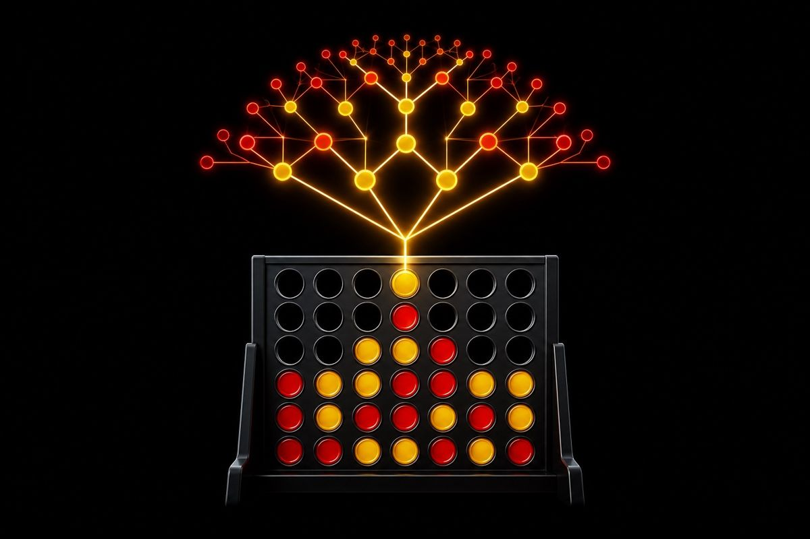

# connectpuct

A Connect Four AI that actually has to play the game, in a browser, against you, instead of just printing a win rate and hoping you believe it.

[](https://github.com/ahmeddoghri/connectpuct/actions/workflows/tests.yml)


[](https://adoghri.com/project-25.html)
[](https://ahmeddoghri.github.io/connectpuct/)



Every game AI repo has a benchmark table. Very few of them let you actually
sit down and lose to the thing. connectpuct ships both: a PUCT-style Monte
Carlo tree search agent in Python with tactical priors for center control,
immediate wins, and blocks, plus a dependency-free browser game at
`web/index.html` you can open and get humbled by in under a minute.

## Run it

```bash
git clone https://github.com/ahmeddoghri/connectpuct
cd connectpuct
pip install -e ".[dev]"
python -m connectpuct.benchmark
```

Then play it yourself at **[ahmeddoghri.github.io/connectpuct](https://ahmeddoghri.github.io/connectpuct/)**,
or open `web/index.html` locally. No server, no build step, no excuse not to.

### The browser game plays the real agent

It didn't always. The first version of the page shipped a three-line stand-in
(win if you can, block if you must, otherwise play center) that was weaker
than either baseline in the benchmark, while this README said you could get
humbled by the search agent. `web/puct.js` is now a line-for-line port of
`engine.py` and `mcts.py`: the same priors, rollouts, and PUCT selection.
Only the random number generator differs, since Python's can't be reproduced
in JavaScript. The page shows where the search spent its visits on every
move, and lets you raise the budget from the benchmarked 40 simulations to
4,000.

`node tests/web_parity.mjs` replays 200 random games through both engines and
requires zero rule disagreements, then checks the 40-simulation JS agent
still beats random and center play (20/20 and 19/20). CI runs it on every
push, so the page can't silently drift back to a stand-in.

## Verified benchmark

Generated locally with `python -m connectpuct.benchmark`:

```text
opponent    wins losses draws win_rate
random      10      0     0    1.00
center      10      0     0    1.00
```

Ten out of ten against a random mover and ten out of ten against an agent
that just grabs the center column. Neither of those is a hard bar, which is
exactly the point. A search agent that cannot clear it has no business
calling itself an agent.

**Update:** I took "neither of those is a hard bar" at its word and built
a real opponent to check. Against depth-3 alpha-beta minimax, no
learning, just correct lookahead, the win rate drops from a perfect
record to roughly 55%: a real contest, not a foregone conclusion.
`python -m connectpuct.benchmark_v2`. Details below.

## What happens against an opponent that isn't a pushover

The README already said the quiet part out loud: beating random and
center-only "is not a hard bar." Here's how weak that bar actually is:
`center_policy` has zero search, no MCTS, no lookahead at all, it just
always plays the center column, and it already beats the random baseline
almost every game on its own. A 10/10 record against random or center
says the agent isn't actively broken. It says nothing about how strong it
is.

`connectpuct/minimax.py` adds a real opponent: depth-limited alpha-beta
minimax with a center-weighted positional heuristic, no learning, no
opening book, just correct lookahead a fixed number of plies deep, the
standard first thing anyone building a game AI reaches for to sanity-check
real strength.

```bash
python -m connectpuct.benchmark_v2
```
```
opponent          wins losses draws win_rate
minimax(depth=3)    11      9     0     0.55
```

20 games, alternating who moves first each game. The record against a
real opponent is close to even, not the sweep the published numbers
imply. This isn't a regression or a bug: the PUCT agent, `mcts.py`, and
the published 10/10-vs-random/center numbers are all untouched and still
reproduce exactly. It's the honest measurement the easy baselines never
provided, and it's a genuinely useful number if you're deciding whether
to trust this agent for anything beyond beating an opponent that plays
the same column every turn.

## Research trail

- OpenSpiel, active game AI benchmark library: https://github.com/google-deepmind/open_spiel
- Speculative Monte Carlo Tree Search, 2024: https://proceedings.neurips.cc/paper_files/paper/2024/file/a19940b01b77b6acd41ff8b32b334e7c-Paper-Conference.pdf
- MCTX JAX Monte Carlo tree search, active OSS: https://github.com/google-deepmind/mctx
- Game AI and procedural content generation benchmark work, 2025: https://arxiv.org/abs/2502.06457

## Tests

```bash
pytest -q
ruff check .
```

MIT © Ahmed Doghri
